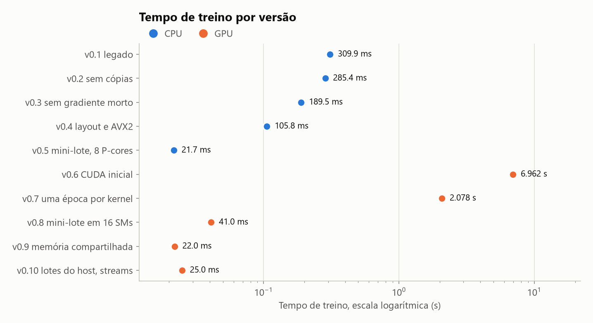
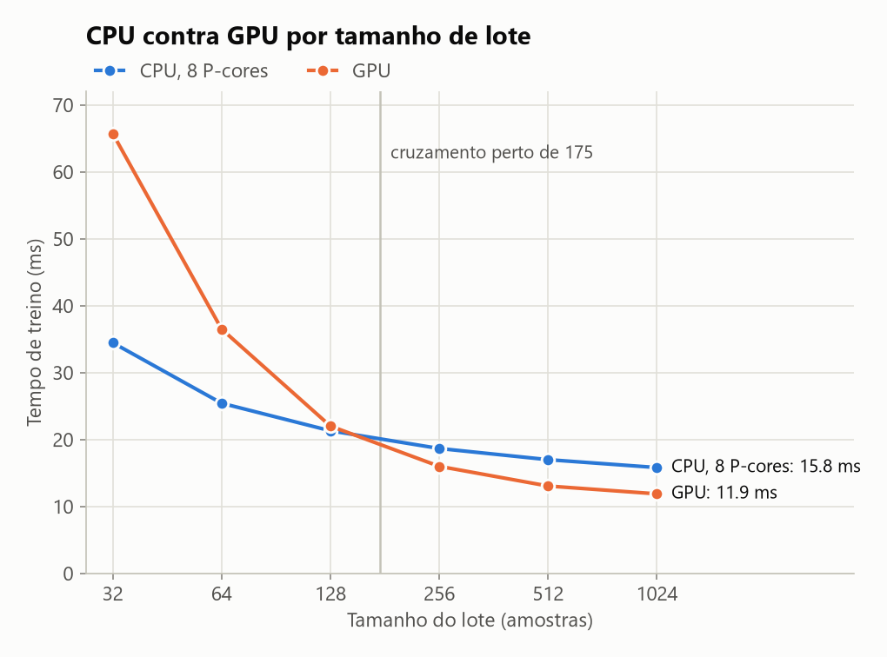

# APS2: relatório executivo

Este bloco resume minha entrega. A discussão completa de cada etapa está nas Issues, e cada linha da tabela abaixo pode ser reproduzida com `git checkout <tag>`. O enunciado original continua logo depois deste sumário, sem alterações.

## Tabela consolidada

| Versão | Tag | Onde roda | Tempo de treino | Ganho sobre o legado | Acurácia | Conferência numérica |
| --- | --- | --- | ---: | ---: | ---: | --- |
| **Baseline Legado** | [`v0.1-baseline`](https://github.com/lucaskmk/awful-barenn/tree/v0.1-baseline) | 1 P-core | 309,9 ms | 1,0x | 95,5% | referência, hash `516bbf84aa2b062` |
| Sem cópias | [`v0.2-sem-copias`](https://github.com/lucaskmk/awful-barenn/tree/v0.2-sem-copias) | 1 P-core | 285,4 ms | 1,09x | 95,5% | igual ao legado |
| Sem gradiente descartado | [`v0.3-sem-gradiente-morto`](https://github.com/lucaskmk/awful-barenn/tree/v0.3-sem-gradiente-morto) | 1 P-core | 189,5 ms | 1,64x | 95,5% | igual ao legado |
| Layout por coluna e AVX2 | [`v0.4-layout-simd`](https://github.com/lucaskmk/awful-barenn/tree/v0.4-layout-simd) | 1 P-core | 105,8 ms | 2,93x | 95,5% | igual ao legado |
| **CPU Otimizada** | [`v0.5-paralelismo-minilote`](https://github.com/lucaskmk/awful-barenn/tree/v0.5-paralelismo-minilote) | 8 P-cores, mini-lote de 128 | 21,7 ms | 14,3x | 96,3% | lote 1 igual ao legado; lote 128 com o mesmo hash de 1 a 24 threads |
| **CUDA Inicial** | [`v0.6-cuda-inicial`](https://github.com/lucaskmk/awful-barenn/tree/v0.6-cuda-inicial) | RTX A1000 | 6.962 ms | 0,04x | 95,5% | igual ao legado |
| Uma época por kernel | [`v0.7-cuda-uma-epoca-por-kernel`](https://github.com/lucaskmk/awful-barenn/tree/v0.7-cuda-uma-epoca-por-kernel) | RTX A1000, 1 de 18 SMs | 2.078 ms | 0,15x | 95,5% | igual ao legado |
| Mini-lote na GPU | [`v0.8-cuda-minilote`](https://github.com/lucaskmk/awful-barenn/tree/v0.8-cuda-minilote) | RTX A1000, 16 de 18 SMs | 41,0 ms | 7,6x | 96,3% | mesmo hash da CPU no lote 128 |
| **CUDA Otimizado** | [`v0.9-cuda-shared-memory`](https://github.com/lucaskmk/awful-barenn/tree/v0.9-cuda-shared-memory) | RTX A1000, memória compartilhada | 22,0 ms | 14,1x | 96,3% | mesmo hash da CPU no lote 128 |
| CUDA com streams | [`v0.10-cuda-streams`](https://github.com/lucaskmk/awful-barenn/tree/v0.10-cuda-streams) | RTX A1000, lotes vindos do host | 25,0 ms | 12,4x | 96,3% | mesmo hash da CPU no lote 128 |

Os tempos de CPU são a mediana de 20 rodadas intercaladas em um único job. Os de GPU são a média de 10 execuções. Os dois lados treinam 51 épocas sobre as 3823 imagens do `optdigits.tra`, e o tempo conta só o treino.



## O que eu concluí

- A CPU ganhou 14,3x sobre o legado e a acurácia subiu de 95,5% para 96,3%. Com `BARENN_LOTE=1` o programa ainda reproduz o legado bit a bit.
- O SGD original atualiza os pesos a cada amostra, então cada amostra depende da anterior. Nesse formato a GPU ficou 100% ocupada e mesmo assim levou 2,08 s, porque só um bloco consegue trabalhar: 1 de 18 SMs.
- O mini-lote foi o que abriu paralelismo real, nos dois lados. Depois disso, memória compartilhada levou a GPU de 41,0 ms para 22,0 ms.
- Com lote de 128, CPU e GPU praticamente empatam (21,3 ms contra 22,0 ms no mesmo job). A GPU tem custo fixo por lote maior (9,2 µs contra 3,1 µs) e custo por amostra menor (47 ns contra 82 ns), e as curvas cruzam perto do lote 175. Para um conjunto maior, em que o lote possa crescer, a GPU leva vantagem.
- Quando os dados vêm do host, a cópia bloqueante dobra o tempo (44,0 ms) e as streams recuperam quase tudo (25,0 ms).



## Índice

| Bloco | Assunto | Issue | Pull Request | Tag |
| --- | --- | --- | --- | --- |
| 1 | Baseline e profiling do legado | [#1](https://github.com/lucaskmk/awful-barenn/issues/1) | [#2](https://github.com/lucaskmk/awful-barenn/pull/2) | [`v0.1-baseline`](https://github.com/lucaskmk/awful-barenn/releases/tag/v0.1-baseline) |
| 2 | Cópias e alocações por amostra | [#3](https://github.com/lucaskmk/awful-barenn/issues/3) | [#4](https://github.com/lucaskmk/awful-barenn/pull/4) | [`v0.2-sem-copias`](https://github.com/lucaskmk/awful-barenn/releases/tag/v0.2-sem-copias) |
| 3 | Gradiente calculado e descartado | [#5](https://github.com/lucaskmk/awful-barenn/issues/5) | [#6](https://github.com/lucaskmk/awful-barenn/pull/6) | [`v0.3-sem-gradiente-morto`](https://github.com/lucaskmk/awful-barenn/releases/tag/v0.3-sem-gradiente-morto) |
| 4 | Layout dos pesos e SIMD | [#7](https://github.com/lucaskmk/awful-barenn/issues/7) | [#8](https://github.com/lucaskmk/awful-barenn/pull/8) | [`v0.4-layout-simd`](https://github.com/lucaskmk/awful-barenn/releases/tag/v0.4-layout-simd) |
| 5 | Paralelismo multicore | [#9](https://github.com/lucaskmk/awful-barenn/issues/9) | [#10](https://github.com/lucaskmk/awful-barenn/pull/10) | [`v0.5-paralelismo-minilote`](https://github.com/lucaskmk/awful-barenn/releases/tag/v0.5-paralelismo-minilote) |
| 6 | Migração inicial para CUDA | [#11](https://github.com/lucaskmk/awful-barenn/issues/11) | [#12](https://github.com/lucaskmk/awful-barenn/pull/12) | [`v0.6-cuda-inicial`](https://github.com/lucaskmk/awful-barenn/releases/tag/v0.6-cuda-inicial) |
| 7 | Kernels e cópias por amostra | [#13](https://github.com/lucaskmk/awful-barenn/issues/13) | [#14](https://github.com/lucaskmk/awful-barenn/pull/14) | [`v0.7-cuda-uma-epoca-por-kernel`](https://github.com/lucaskmk/awful-barenn/releases/tag/v0.7-cuda-uma-epoca-por-kernel) |
| 8 | Mini-lote ocupando os SMs | [#15](https://github.com/lucaskmk/awful-barenn/issues/15) | [#16](https://github.com/lucaskmk/awful-barenn/pull/16) | [`v0.8-cuda-minilote`](https://github.com/lucaskmk/awful-barenn/releases/tag/v0.8-cuda-minilote) |
| 9 | Memória compartilhada | [#17](https://github.com/lucaskmk/awful-barenn/issues/17) | [#18](https://github.com/lucaskmk/awful-barenn/pull/18) | [`v0.9-cuda-shared-memory`](https://github.com/lucaskmk/awful-barenn/releases/tag/v0.9-cuda-shared-memory) |
| 10 | Streams para dados vindos do host | [#19](https://github.com/lucaskmk/awful-barenn/issues/19) | [#20](https://github.com/lucaskmk/awful-barenn/pull/20) | [`v0.10-cuda-streams`](https://github.com/lucaskmk/awful-barenn/releases/tag/v0.10-cuda-streams) |
| 11 | Comparação final e metodologia | [#21](https://github.com/lucaskmk/awful-barenn/issues/21) | [#22](https://github.com/lucaskmk/awful-barenn/pull/22) | [`v1.0-relatorio-final`](https://github.com/lucaskmk/awful-barenn/releases/tag/v1.0-relatorio-final) |

## Como reproduzir

Tudo roda no Franky. O compute20 é um Intel i9-14900 com uma NVIDIA RTX A1000 de 8 GB, e os nós de GPU têm o CUDA 12.8.1 no caminho indicado em `scripts/ambiente_cuda.sh`.

```bash
git checkout v0.9-cuda-shared-memory
source scripts/ambiente_cuda.sh
make && make cuda

# Compara a saída com a referência, bit a bit
srun -p pluton_gpu --gres=gpu:1 --exclusive scripts/valida.sh ./barenn_cuda_hash
BARENN_LOTE=128 srun -p pluton_gpu --gres=gpu:1 --exclusive scripts/valida.sh ./barenn_cuda_hash resultados/referencia_lote128.txt

# Mede o tempo com 10 repetições, em um nó exclusivo
sbatch scripts/medir.slurm ./barenn_cuda 10
CPU=0,2,4,6,8,10,12,14 OMP_NUM_THREADS=8 sbatch scripts/medir.slurm ./barenn 10
```

As tags até a `v0.4` são só CPU e compilam com `make`. As tags a partir da `v0.6` precisam do `source scripts/ambiente_cuda.sh` antes do `make cuda`. As variáveis `BARENN_LOTE` (tamanho do lote) e `BARENN_DADOS` (`residente`, `copia` ou `streams`, a partir da `v0.10`) mudam o modo de execução sem recompilar.

Duas limitações que afetam a leitura dos números:

- O clock efetivo do P-core muda de um job para outro no compute20, entre 4,76 e 5,75 GHz. Por isso as versões de CPU foram comparadas no mesmo job, com as execuções intercaladas, e eu também reporto ciclos. Os detalhes estão na [Issue #21](https://github.com/lucaskmk/awful-barenn/issues/21).
- O Nsight Compute não funciona para o meu usuário no Franky (`ERR_NVGPUCTRPERM`), e as GPU Metrics do Nsight Systems também não. Usei Nsight Systems para tempos de kernel e de cópia, e medi a ocupação real dos SMs com instrumentação própria (`%smid` e `clock64()`), compilada com `-DBARENN_OCUPACAO`.

---

# Projeto Barenn: O Legado, a Sobrevivência e o Salto para a GPU

Era uma segunda-feira aparentemente tranquila quando a demanda chegou à sua mesa. A liderança técnica se aproximou com um sorriso contido e soltou aquela frase clássica que faz qualquer engenheiro gelar por dentro:

> "Temos um componente crítico rodando em produção há anos. O desenvolvedor original já saiu da empresa, mas agora o projeto é oficialmente seu."
    
Você procurou documentação, manuais ou notas de arquitetura e não encontrou rigorosamente nada. Restou apenas um código hermético a correr em produção.

Depois de analisar o código entendeu que é a implementação de uma Feedforward Neural Network, mas por que razão reinventar a roda? No passado, exigências estritas de conformidade e restrições de licenciamento impediram o recurso a bibliotecas de mercado. Sem alternativa, a empresa optou por criar a sua própria implementação de raiz. O resultado funcionou durante anos, mas tornou-se um labirinto técnico esquecido.

Com o aumento exponencial do volume de dados, a máquina atual começou a falhar nos prazos operacionais. Antes de qualquer migração complexa, **o seu primeiro desafio é estabilizar o código e espremer todo o desempenho possível da CPU — atacando gargalos, repensando o acesso à memória e explorando o paralelismo nativo.**

Para resolver o problema a longo prazo, a empresa adquiriu servidores blade equipados com GPUs corporativas NVIDIA. O hardware de alto desempenho já está montado no datacenter: **a sua missão final é reescrever os pontos críticos do algoritmo em CUDA e levar o processamento ao nível do paralelismo massivo.**

---

## Diretrizes de Conduta e Governança no Repositório

Neste projeto, o repositório não é apenas um local de entrega de arquivos, mas a **comprovação do seu processo investigativo de engenharia**. Espera-se uma postura estritamente empírica: nenhuma otimização deve ser feita no escuro e nenhuma melhoria de velocidade tem valor se corromper o resultado final do programa.

---

### O Princípio do Bloco Lógico de Trabalho

Você tem autonomia para decidir **o que** otimizar e **em qual ordem**, mas cada entrega deve ser estruturada como um **bloco lógico fechado**.

> **O que é um bloco lógico?**
> É uma unidade completa de intervenção técnica que engloba: **um problema identificado por profiling $\rightarrow$ uma hipótese de melhoria $\rightarrow$ a alteração no código $\rightarrow$ a validação da corretude $\rightarrow$ a medição do ganho real.**

* **Não crie tags por tempo decorrido:** Evite tags como `versao-dia-2` ou commits de "fim de expediente".
* **Não crie tags para alterações inconclusivas:** Se a alteração piorou o desempenho ou quebrou os testes, documente na Issue, reverta ou ajuste antes de formalizar o marco.
* **Toda tag deve ser reprodutível:** O professor ou qualquer colega deve conseguir executar `git checkout <tag>`, compilar o código e obter exatamente o mesmo comportamento e ordem de grandeza de desempenho documentados.

---

### O Fluxo Esperado no GitHub

Para cada intervenção técnica planejada, seu ciclo de trabalho no repositório deve seguir três pilares:

#### 1. Abertura de Issue (A Hipótese e o Ponto de Partida)

Antes de alterar uma única linha de código, abra uma Issue explicando a intenção do bloco lógico:

* **Diagnóstico:** Qual gargalo você encontrou usando ferramentas de análise (profilers)?
* **Hipótese:** Qual conceito técnico você pretende aplicar para resolver esse gargalo?
* **Métrica Base:** Qual é o tempo ou custo de processamento atual dessa rotina?

#### 2. Desenvolvimento Isolado e Commits Semânticos

* Trabalhe em uma *branch* dedicada àquela hipótese.
* Faça commits descritivos focados na causa da mudança (ex: `perf: ...`, `refactor: ...`, `fix: ...`).
* Certifique-se de que a saída do modelo/algoritmo continua correta. Código rápido que calcula resultados errados é considerado código quebrado.

#### 3. Formalização com Tag Anotada e Fechamento da Issue

Quando o bloco estiver concluído e validado, crie uma **Git Tag anotada**:

* A tag marca o estado exato da base de código naquele degrau de maturidade.
* A mensagem da tag deve resumir sucintamente o resultado alcançado.
* Feche a Issue anexando as evidências (dados de tempo, prints do profiler ou tabelas comparando o "antes e depois").

---

### Exemplo Ilustrativo de um Bloco Lógico

*(Este é apenas um exemplo de como organizar a narrativa técnica e as ferramentas; não representa um passo obrigatório ou a solução do seu problema).*

---

#### 1. Cenário: O aluno percebeu lentidão na etapa de processamento sequencial

* **Abertura da Issue #04:**
> **Título:** *Redução de tempo de computação na rotina de cálculo vetorial*
> **Contexto:** Ao inspecionar o código com o profiler, identificou-se que 65% do tempo de execução é consumido em um laço interno que realiza operações matemáticas repetitivas.
> **Métricas atuais:** Tempo total de execução: `14.2s`.
> **Hipótese:** Reestruturar a ordem dos dados para favorecer o uso de registradores e paralelizar o laço com múltiplos núcleos deve reduzir o tempo dessa rotina.


* **Implementação na branch:** `feature/otimizacao-laco-vetorial`
* Commits atômicos ajustando o laço e aplicando a estratégia escolhida.
* Verificação de que o resultado final do programa bate com o original.


* **Criação da Tag:**
```bash
git tag -a v0.3-laco-paralelo -m "Otimizacao do calculo vetorial: tempo reduzido de 14.2s para 4.8s (Speedup 2.95x). Corretude validada."
git push origin v0.3-laco-paralelo

```


* **Fechamento da Issue:**
* O aluno responde na Issue #04 anexando o comparativo de tempo (antes: `14.2s` / depois: `4.8s`), faz o merge da branch e referencia a tag criada:


> *"Otimização implementada e validada na tag `v0.3-laco-paralelo`. Issue fechada pelo PR #05."*


---

# Rubrica de Avaliação (Total: 10,0 Pontos)

<div style="background:rgba(255, 0, 0, 0.65)"> 

> ### ⚠️ CLÁUSULA ELIMINATÓRIA GERAL (CONDIÇÃO DE NOTA ZERO)
> 
> 
> A avaliação adota uma política estrita de controle de qualidade de engenharia:
> **Se em QUALQUER um dos critérios ou subcritérios de avaliação for observado o indicativo de `0,0 ponto`, a ATIVIDADE SERÁ INTEGRALMENTE ZERADA (Nota Final = 0,0).**
> Não é tolerada a ausência completa de qualquer pilar fundamental da atividade (seja por código inoperante/incorreto, falta de governança no Git ou ausência de embasamento empírico nas Issues).

* **Implementação e Desempenho Técnico:** 4,0 pontos
* **Governança, Reprodutibilidade e Tags:** 2,0 pontos
* **Relatório Técnico nas Issues (Análise e Discussão):** 4,0 pontos

</div>

---

### Critério 1: Implementação e Desempenho Técnico (4,0 pontos)

* **0,0 ponto [ZERA A ATIVIDADE]** — O código não compila, aborta durante a execução, não é funcional ou gera saídas matematicamente corrompidas.
* **+0,5 ponto** — Executou com sucesso o código legado, mediu o baseline de referência de forma reproduzível e identificou os gargalos iniciais.
* **+1,0 ponto** — Aplicou otimizações eficazes na CPU com ganhos consistentes de velocidade e paralelismo multicore preservando a integridade numérica.
* **+1,0 ponto ** — **Migração Funcional para CUDA:** Porting inicial para GPU completo e correto (kernel funcional, alocação e liberação de memória no Device e transferências Host/Device íntegras).
* **+0,75 ponto** — Otimizou a execução em GPU.
* **+0,75 ponto** — Implementou técnicas avançadas em GPU, comprovando ganhos.

---

### Critério 2: Governança, Reprodutibilidade e Tags (2,0 pontos)

* **0,0 ponto [ZERA A ATIVIDADE]** — Ausência de tags, ou repositório com commit único ("tudo pronto") / commits lineares sem separação lógica, inviabilizando a reprodutibilidade dos marcos intermediários.
* **+0,5 ponto** — Utilizou tags, mas elas marcam datas/horários arbitrários em vez de blocos lógicos fechados de trabalho, ou as tags não compilam de forma independente.
* **+1,2 ponto** — Trabalho estruturado em **blocos lógicos**: cada intervenção possui uma Git Tag anotada associada a uma Issue, permitindo compilar e checar a métrica de cada versão via `git checkout <tag>`.
* **+2,0 pontos** — Reprodutibilidade e histórico impecáveis: commits atômicos com mensagens semânticas (`perf:`, `refactor:`, `test:`), branches limpas integradas via Pull Requests documentados e rastreabilidade total de cada degrau de performance.

---

### Critério 3: Relatório Técnico nas Issues (Análise e Discussão) (4,0 pontos)

#### 3.1 Profiling e Evidências Empíricas (1,5 ponto)

* **0,0 ponto [ZERA A ATIVIDADE]** — Não apresenta dados de medição nas Issues ou baseia-se unicamente em impressões subjetivas sem qualquer dado empírico.
* **+0,5 ponto** — Apresenta apenas tempos brutos de relógio (*wall-clock*) colados em texto corrido, sem dados de profilers ou repetições estatísticas.
* **+1,0 ponto** — Apresenta dados e capturas das ferramentas oficiais (**perf/callgrind** e **Nsight Systems/Compute**), mas faltam informações cruciais de ambiente (flags, parâmetros de teste ou hardware).
* **+1,5 ponto** — Issues contêm relatórios completos de profiling (CPU e GPU), métricas de hardware detalhadas (tempo de kernel vs transferência PCIe, cache misses, ocupação teórica vs real de SMs) e metodologia experimental rigorosa.

#### 3.2 Qualidade da Discussão Técnica e Argumentação de Engenharia (2,5 pontos)

* **0,0 ponto [ZERA A ATIVIDADE]** — Discussão inexistente, Issues fechadas apenas com "ok/concluído" ou explicações inconsistentes/conflitantes com os dados coletados.
* **+1,0 ponto** — Discussão puramente descritiva (lista o que foi alterado nas linhas de código, mas não analisa *por que* houve ou não ganho com base em hardware).
* **+1,8 ponto** — Discute tecnicamente a relação entre o código e o comportamento de hardware (ex: impacto do layout de memória nos caches da CPU, balanceamento de carga entre threads).
* **+2,5 pontos** — Análise técnica aprofundada: correlaciona os resultados com conceitos avançados de arquitetura (roofline model, limites da Lei de Amdahl, latência do PCIe vs throughput do kernel CUDA) e debate criticamente as decisões de engenharia tomadas.

---

## Tabela de Cenários e Balizadores

| Cenário | Situação Técnica no GitHub | Resultado / Nota |
| --- | --- | --- |
| **Desclassificado** | Tirou `0,0` em qualquer critério (ex: código não compila, sem tags, sem dados de profiling nas issues ou issues vazias). | **0,0 (Zerada)** |
| **Abaixo do Esperado** | Código compila e funciona, mas há otimizações superficiais, profiling fraco e tags incompletas. | **0,1 a 5,9** |
| **Linha de Base (Alvo: 6,0)** | CPU razoavelmente otimizada + **Migração simples para CUDA funcional** + Issues estruturadas com diagnóstico e tags atreladas. | **6,0 a 6,5** |
| **Avançado / Destaque** | CPU altamente eficiente + **CUDA com otimizações avançadas (Shared Memory/Streams)** + discussões ricas nas Issues com Nsight/Perf + governança impecável. | **8,5 a 10,0** |

---

## Formato de Entrega

A entrega consiste exclusivamente no **link do repositório no GitHub**.

1. O `README.md` principal deve atuar como o **sumário executivo do relatório**, sendo adiciocionado **NO TOPO DO README**:
* A tabela consolidada final comparando todas as versões (Baseline Legado, CPU Otimizada, CUDA Inicial, CUDA Otimizado);
* Um **índice navegável com links diretos** para cada uma das Issues/Tags que contêm a discussão detalhada;

2. Todas as branches de trabalho devem estar integradas à `main`;
3. Todas as Issues de experimentos devem estar fechadas e associadas à sua respectiva Git Tag anotada.
